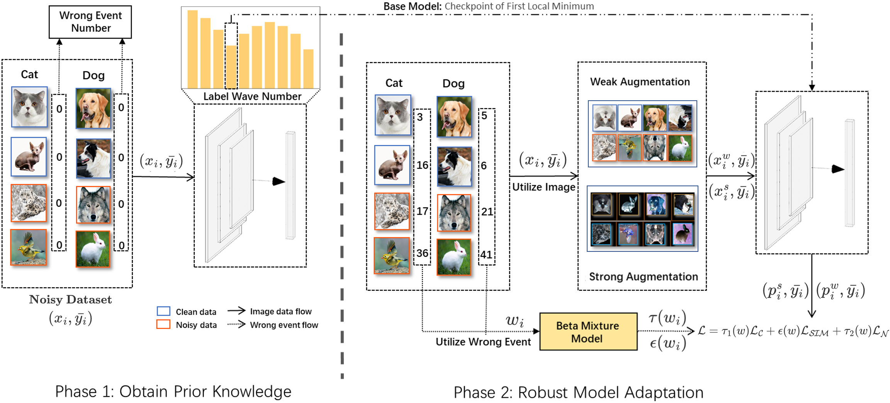

# NeurIPS 2025 [IDO: Handling Label Noise via Instance-Level Difficulty Modeling and Dynamic Optimization] Implementation

[](LICENSE)
[](https://www.python.org/)
[](https://pytorch.org/)

This repository is the official implementation of the paper "Handling Label Noise via Instance-Level Difficulty
Modeling and Dynamic Optimization". It includes complete training, validation, and inference pipelines.

## 📌 Overview

We propose IDO, an Instance-level Difficulty Modeling and Dynamic Optimization framework to achieve robust learning over noisy training data. Rather than relying on hyperparameters to regularize different terms in the loss function, IDO designs a dynamically weighted loss function that captures both the cleanliness and difficulty of each individual sample.
This enables instance-level optimization without introducing any additional hyperparameter.

## 🚀 Key Features

- A simple but robust metric - wrong event
- A dynamic loss function considering clean, hard and noise information
- A two-stage framework using pre-trained models to handle noisy labels

## 📂 Project Structure

```plaintext
.
├── config/               # Training configuration files
├── checkpoint/           # The logs files
├── dataloader/           # Data loading and preprocessing
├── model/                # Model Loading
├── utils/                # Utility scripts
├── stage1/               # Statistical data collected during Stage 1
├── stage2/               # Statistical data collected during Stage 2
├── sh/                   # Execution scripts of different datasets
├── stage_1.py            # Code of Stage 1
├── stage_2.py            # Code of Stage 2 (whole dataset bmm)
├── stage_2_class.py      # Code of Stage 2 (class-based bmm)
└── requirements.txt      # Python dependencies
```

## ⚙️ Environment Setup

```
conda create -n IDO python=3.8
conda activate IDO
pip install -r requirements.txt
```

## 🛠️ Quick Start

```
Data Preparation
Download cifar100, tiny-imagenet, cifar100-N, clothing1m, webvision.
```

Extract files to './data/' directory (create if missing).

### Running Py Files 

Stage 1 Training

```
# real-world dataset
python stage_1.py --config 'config/stage1/[dataset].yaml' 
# synthetic dataset
python stage_1.py --config 'config/stage1/[dataset].yaml' --noise_mode ['sym' 'asym' 'idn'] --noise_ratio [0,1]
```

Stage 2 Training

```
# real-world dataset
python stage_2.py --config 'config/stage2/[dataset].yaml' 
# synthetic dataset
python stage_2.py --config 'config/stage2/[dataset].yaml' --noise_mode ['sym' 'asym' 'idn'] --noise_ratio [0,1]
```

### Running sh Files

```
sh sh/[cifar100.sh, tiny_imagenet.sh,realworld.sh]
```

### Procedure Document

1. After finishing stage 1, the wrong event information and a bar chart will be stored into './stage1'.
2. After finishing stage 1, a competitive base model will be stored into './base_model'.
3. After finishing stage 2, the best accuracy will be stored into './stage2'.
4. The training log files will be stored into './checkpoint'.

## 📜 Citation

```
@inproceedings{IDO,
  title     = {Handling Label Noise via Instance-Level Difficulty Modeling and Dynamic Optimization},
  author    = {Zhang, Kuan and Chai, Chengliang and Xu, Jingzhe and Zhang, Chi and Han, Han and Yuan, Ye and Wang, Guoren and Cao Lei},
  booktitle = {NeurIPS},
  year      = {2025}
}
```

## 🤝 Contributing

Open an issue or submit a PR. Follow the contribution guidelines.

## 📄 License

MIT License. See LICENSE.

